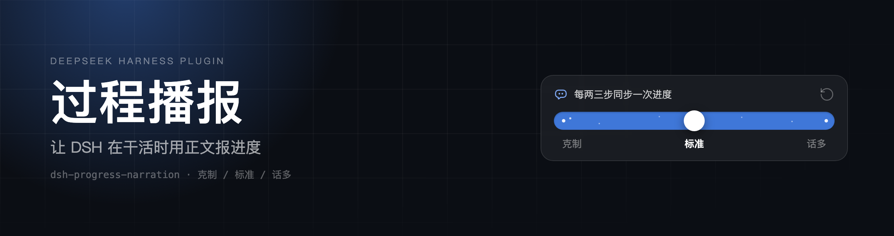
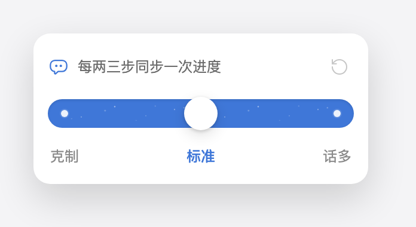

<p align="center">
  
</p>

<h1 align="center">过程播报 · dsh-progress-narration</h1>

<p align="center"><strong>Prose progress updates while DeepSeek Harness works, instead of one long report at the end</strong></p>

<p align="center">
  <a href="https://www.npmjs.com/package/dsh-plugin-progress-narration"></a>
  <a href="https://github.com/jevonhou/dsh-progress-narration/releases"></a>
  <a href="LICENSE"></a>
  
</p>

<p align="center">English · [**中文**](README.md)</p>

---

## Why

On a long task, DSH tends to run tools silently and then dump one long conclusion. All you see in between is a stream of reasoning, command and file-read rows.

This plugin makes it write a sentence or two at each stage: **what it just did, what it found, what comes next**. You can tell whether it is on track without waiting for the end.

Codex gets a similar effect from its base prompt (`Intermediary updates`) and a dedicated commentary channel. DSH ships without that layer, so this plugin adds it.

## What it does

- A tone icon sits on the right of the composer and **shows the current density** (1 dot / 2 dots / 3 solid dots).
- Clicking it opens a three-stop density slider that applies immediately:

| Mode | Cadence |
|---|---|
| 克制 (quiet) | Only before edits and at key turning points |
| 标准 (standard, default) | Syncs progress every two or three steps |
| 话多 (chatty) | One update per completed step |

- The circular arrow resets to the default mode.
- Silence guard: after 6 / 3 / 2 consecutive tool-only steps (matching the mode), the plugin injects a short reminder into the next request.




## Install

**Requires** DeepSeek Harness `0.2.2-rc.1` or newer. Verified on macOS; other platforms untested.

### From npm (recommended)

1. Open **Settings → Plugins** and click **Add plugin**.
2. Enter the package name: `dsh-plugin-progress-narration`
3. Confirm that “过程播报” is enabled in the plugin list.

### From GitHub

1. Open **Settings → Plugins** and click **Add plugin**.
2. Paste the repository URL: `https://github.com/jevonhou/dsh-progress-narration`
3. Confirm that “过程播报” is enabled in the plugin list.

Clone and paste the absolute path of the directory into the same field if you prefer a local install:

```bash
git clone https://github.com/jevonhou/dsh-progress-narration.git
```

> If GitHub times out, the install dialog offers a mirror registry.

Verify: the plugin appears in the list and an uninstall entry exists under Settings → Plugins. Install verification details are in the Chinese README.

## How it works

**Host half** (`index.js`)

- `narration:policy` — a standing system-prompt section explaining that prose is what the user sees, that reasoning is folded, and how often to speak.
- `narration:silence` — runtime context that reads the session's derived history, counts consecutive tool-only assistant steps, and only injects a reminder once per threshold. Nothing is added while the model keeps narrating.
- The policy section is static text, so it stays KV-cache friendly.

**Client half** (`client.js`)

- Registers `conversation.input.right` (composer icon) and `shell.overlay` (panel).
- The panel reuses the official `MenuSurface` + `useAnchoredPosition`, and colours come from theme tokens, so light and dark themes both work.
- Preferences are read and written through `configForms`; no fake user messages are injected.

## Known limits

- Prompting and reminders **raise the probability**, they do not guarantee it: the model may still stay silent in some turns.
- Costs a small amount of output tokens; the chatty mode is more noticeable on long tasks.
- Subagents are excluded, so team-internal chatter does not leak into your view.
- Editing `client.js` requires **restarting Harness**: the Host caches client bundles by `rev`, so a page refresh may serve the old bundle — and a broken bundle makes the page fail to boot.

## Development

Host + Client halves, plain JS, no dependencies, no build step.

| File | Role |
|---|---|
| `index.js` | Prompt section, silence reminder, writable config schema |
| `client.js` | Composer icon and density panel |
| `cordis.patch.yml` | Plugin row |
| `locale/` | Localized title and description |
| `icon.svg` | Plugin icon (36×36) |
| `design/` | Banner and README screenshots |

Styling note: Harness's global styles render corners as a squircle (`corner-shape`). When you want a real pill or circle, set `corner-shape: round` explicitly; otherwise `border-radius: 12px` produces a rounded rectangle.

Local loop: install the repository directory through **Add plugin**. After editing `client.js`, **a restart alone may not be enough**: the Host keys its client-script cache by the package directory's rev, and editing `client.js` does not change it, so the renderer keeps hitting the old response. Bump `package.json` (version is enough) or reinstall to force a refetch.

## License

[MIT](LICENSE)
