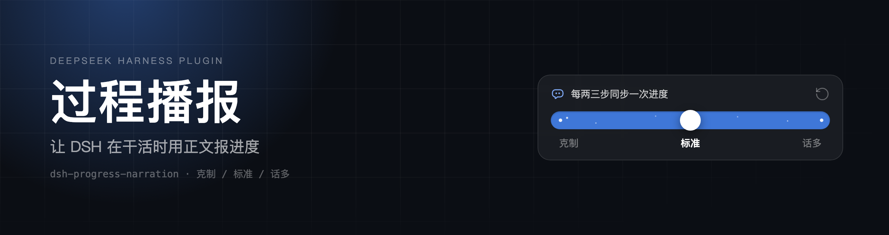
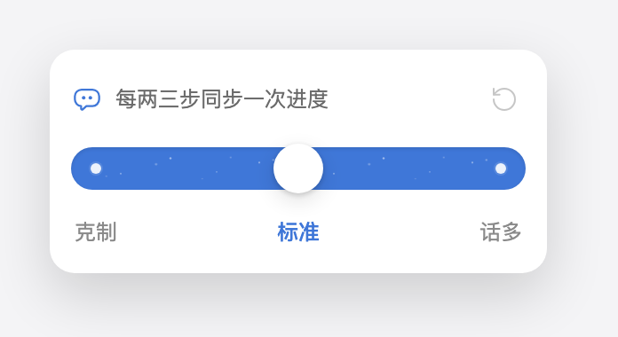

<p align="center">
  
</p>

<h1 align="center">过程播报 · dsh-progress-narration</h1>

<p align="center"><strong>让 DSH 在干活时用正文报进度，而不是憋到最后一次性汇报</strong></p>

<p align="center">
  <a href="https://www.npmjs.com/package/dsh-plugin-progress-narration"></a>
  <a href="https://github.com/jevonhou/dsh-progress-narration/releases"></a>
  <a href="LICENSE"></a>
  
</p>

<p align="center">[**English**](README.en.md) · 中文</p>

---

## 它解决什么

长任务里，DSH 往往一路沉默地跑工具，最后突然给一大段结论。你看到的是一行行「思考 / 运行命令 / 读取文件」，中间没有落点。

装上这个插件，DSH 会在每个阶段先写一两句正文：**刚做了什么、发现了什么、下一步做什么**。你能在过程中判断它有没有跑偏，不必等它做完。

类似体验在 Codex 里来自它的基座提示词（`Intermediary updates` 一节）和独立的 commentary 通道；DSH 默认没有这一层，这个插件把它补上。

## 功能

- 输入框右侧有语气图标，**图标本身显示当前档位**（1 点 / 2 点 / 3 点实心）
- 点开是三档密度滑轨，切换即时生效：
- 右上角圆形箭头是「重置为默认」
- 沉默兜底：连续 6 / 3 / 2 步没有正文（对应当前档位）时，插件会在下一步请求里插一条提醒

| 档位 | 节奏 |
|---|---|
| 克制 | 只在动手前和关键转折说一句 |
| 标准（默认） | 每两三步同步一次进度 |
| 话多 | 每完成一步就说一句 |




## 安装

**前置要求**：DeepSeek Harness `0.2.2-rc.1` 或更新版本。已在 macOS 上验证；其他平台未实测。

### 从 npm 安装（推荐）

1. 打开「设置 → 插件」，点右上角「添加插件」；
2. 输入包名：`dsh-plugin-progress-narration`
3. 按提示完成安装，回到插件列表确认已启用。

### 从 GitHub 安装

1. 打开「设置 → 插件」，点右上角「添加插件」；
2. 粘贴仓库地址：`https://github.com/jevonhou/dsh-progress-narration`
3. 按提示完成安装，回到插件列表确认「过程播报」已启用。

### 从本地目录安装

```bash
git clone https://github.com/jevonhou/dsh-progress-narration.git
```

把克隆后的目录**绝对路径**粘贴到同一个输入框即可。

> 如果提示连接 GitHub 超时，安装对话框里可以切换到国内镜像源。

### 验证与卸载

会话输入框右侧出现带点的气泡图标即安装成功。卸载：设置 → 插件 → 过程播报 → 卸载。

## 设置与数据

偏好存在插件自己的设置命名空间里（`mode` 为 `volatile()` 字段），面板上的改动即时生效，不写进你的其他配置。

## 原理

**Host 半边**（`index.js`）

- `narration:policy`：常驻系统提示段，告诉模型「正文才会被看到、推理会被折叠、多久说一次」；
- `narration:silence`：运行上下文，读取会话派生历史，统计连续多少个助手步骤只调工具、没有正文，越线时才插入提醒（不越线不占提示词）；
- 提示段为静态文本，KV 缓存友好。

**Client 半边**（`client.js`）

- 注册 `conversation.input.right`（输入框图标）与 `shell.overlay`（面板）；
- 面板外壳使用官方 `MenuSurface` + `useAnchoredPosition`，颜色全部走主题 token，亮/暗主题自适应；
- 通过 `configForms` 读写自己的设置，不注入伪造的用户消息。

## 已知限制

- 提示词与提醒只能**提高概率**，不是硬保证：模型仍可能在某些回合选择不说。
- 会增加少量输出 token，`话多` 档在长任务里更明显。
- 子代理不参与提醒，避免团队内部对话刷屏。
- 修改 `client.js` 后必须**重启 Harness**：Host 按 `rev` 缓存客户端包，仅刷新页面可能拿到旧包；旧包若有语法错误还会导致页面启动失败。

## 开发

Host + Client 双半边，纯 JS、无依赖、无构建步骤。

| 文件 | 作用 |
|---|---|
| `index.js` | 提示段、沉默提醒、可写配置 schema |
| `client.js` | 输入框图标与语气面板 |
| `cordis.patch.yml` | 插件行声明 |
| `locale/` | 插件列表中的中英文标题与说明 |
| `icon.svg` | 插件图标（36×36） |
| `design/` | README 用截图与 banner |

样式注意：Harness 的全局样式会把圆角渲染成 squircle（`corner-shape`），需要真正的胶囊/圆形时必须显式写 `corner-shape: round`，否则 `border-radius: 12px` 出来的是圆角矩形。

本地调试：把仓库目录粘贴进「添加插件」安装即可。改 `client.js` 后**光重启不一定生效**：Host 用包目录的 rev 做客户端脚本缓存键，只改 `client.js` 不会改变 rev，浏览器会一直命中旧响应。改一下 `package.json`（例如版本号）或卸载重装，才会重新取包。

## License

[MIT](LICENSE)
